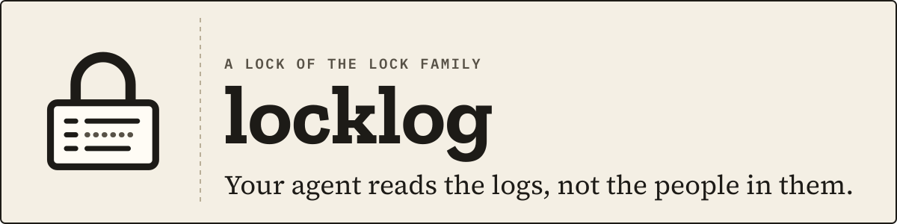

<p align="center">
  <picture>
    <source media="(prefers-color-scheme: dark)" srcset="docs/assets/banner-dark.svg">
    
  </picture>
</p>

<p align="center">
  <a href="https://github.com/DavidGodefroid/locklog/actions/workflows/ci.yml"></a>
  <a href="https://github.com/DavidGodefroid/locklog/releases"></a>
  <a href="LICENSE"></a>
  <a href="go.mod"></a>
</p>

<p align="center"><b>Let any AI agent investigate your logs: counts, patterns and traces come back<br>
with emails, IPs and secrets masked, and a value in clear waits for you.</b></p>

<p align="center">
  
</p>
<p align="center"><sub>An agent (here Claude Code, left) and <code>lox run</code> (right, outside the agent): free calls come back masked, an unmask waits for you.</sub></p>

<p align="center">
  <a href="#quick-start">Quick start</a> ·
  <a href="#how-it-works">How it works</a> ·
  <a href="#documentation">Docs</a> ·
  <a href="#the-lock-family">Lock Family</a> ·
  <a href="https://locklog.dev">locklog.dev</a>
</p>

---

locklog is a Lock of the [Lock Family](https://github.com/DavidGodefroid/lockfamily),
harness security for AI agents. A **console** held by a human reads your
logs; the agent asks over MCP and gets masked, bounded, typed answers:
counts, patterns, traces, lines around a hit.

> [!NOTE]
> **Pre-release** (`v0.2.x`). The console is started by `lox run` only, from
> the lockhub release after v0.9.0. See [the install status](docs/install.md#status).

## Why locklog

- **Masked before the model.** Emails, IPs, card numbers, national ids and
  the other values locklog detects become pseudonyms
  (`⟦email:7F3KQ2M9ZD4X⟧`); secrets become `⟦secret⟧`.
- **The agent never holds the logs.** It never reads files, the Docker
  socket or a backend's credentials: the console does, in its own account
  and container.
- **Approval outside the agent.** Reads within budgets are free. A scan
  beyond a budget or a value in clear is a ticket that waits for you in
  `lox run`, and unmask is off by default on production.
- **Read-only.** No write path to any log or backend, and every call is
  audited without clear values.

## Install

```sh
brew trust davidgodefroid/tap
brew install davidgodefroid/tap/lockfamily
```

That installs the Lock Family (`lox` and the other Locks). locklog joins it,
with `brew install davidgodefroid/tap/locklog` and `lox add locklog`, in the
lockhub release after v0.9.0. Until then, the signed install script
installs locklog's launcher:

```sh
curl -fsSL https://locklog.dev/install.sh | sh
```

A Linux host with the logs, Docker ≥ 19.03 and
[cosign](https://docs.sigstore.dev/cosign/system_config/installation/).
Status, the script read first, and production placement:
[docs/install.md](docs/install.md).

## Quick start

On a **non-production** profile first (a host agent runs on your own
account, where it could still read the logs directly):

1. In your project, add the lock. `lox add` builds a profile from the logs
   this host has (never a secret), wires your agent and checks the setup:

   ```sh
   cd ~/projects/shop
   lox add locklog
   ```

2. In a terminal of its own, outside any agent, keep `lox run` open. It
   starts the console, and every ticket shows up there:

   ```sh
   lox run
   ```

3. Start your agent in the project (`claude`, `codex`, `gemini`, …) and ask:
   *"when did the 502s start?"*

`lox add` wires Claude Code; for Codex, Cursor or Gemini CLI, also run
`locklog init codex` (or `cursor`, `gemini`). On production, run the agent
in [lea](https://github.com/DavidGodefroid/lea) or in its own container
([docs/setup.md](docs/setup.md#the-own-container-recipe)).

## Highlights

<table>
<tr>
<td width="50%" valign="top">

**🕶️ Masked by construction**<br>
Every record is masked before any predicate runs. A clear email in a query
is refused; equality on a pseudonym still finds one user's records.

</td>
<td width="50%" valign="top">

**🔎 Investigation tools, not a query language**<br>
`locklog_count`, `locklog_patterns`, `locklog_trace`, `locklog_context`,
`locklog_search`, `locklog_tail`. Text never goes to a backend.

</td>
</tr>
<tr>
<td valign="top">

**⚖️ Free within budgets, approved beyond**<br>
Reads are bounded per call and per hour. `locklog_scan` asks you once for
its whole plan.

</td>
<td valign="top">

**📚 Your sources**<br>
Files (rotation, gzip, zstd), journald, Docker container logs and Loki;
Elasticsearch and OpenSearch as a preview.

</td>
</tr>
</table>

More: [the highlights in full and a comparison](docs/architecture.md#highlights-in-full).

## How it works

```
 host (you)
   lox run (lockhub): the hub and the decisions, in a terminal of its own
     └─ console container   uid 10051, no capability, read-only root,
          read-only binds of the approved log directories,
          pseudonym keys, index and audit in its own volume
 agent (lea, your own container, or the host for the trial)
   MCP server `locklog mcp` → the console's socket (peer uid checked by the kernel)
```

1. The console reads the approved sources, and only those.
2. Each call gets a byte plan from the time range and trusted selectors
   only; admission and stopping points never depend on what matched.
3. Every record is masked first; then the agent's predicates run on the
   masked view.
4. The answer leaves capped, as JSON under an "untrusted content" header.

Reads within budgets are free and audited. A scan beyond a budget, an
unmask or an approved lookup is a ticket at `lox run`; a profile's auto
rules (`auto`, `ask`, `deny`) decide which `lox run` may approve alone, and
the default asks you. The full layout, the decision table, the sources and
the masking benchmark: [docs/architecture.md](docs/architecture.md).

## Safety model

- **The console is the enforcement point.** It alone reads logs, holds
  credentials and pseudonym keys, and decides what leaves.
- **OS separation.** Only the clients group, the image's `agent` and the
  uids you list reach the socket, never root; no Docker socket in any
  locklog container.
- **Approvals bound to the plan.** Single use; an unmask re-reads the
  record and is refused if anything moved. Secrets are never unmasked.
- **Preconditions.** The agent must not reach the logs another way (P1),
  agents of one uid are one trust domain (P2), and only the console holds
  backend read credentials (P3). `locklog doctor` checks the usual ways P1
  fails.
- **Known limits.** locklog masks what it detects: person names (unless
  opted in), usernames in free text, postal addresses, private IPs and
  business ids are not. Pseudonymised data is still personal data under the
  GDPR.

Threat model, invariants, what is not masked and retention:
[docs/security-model.md](docs/security-model.md).

## Documentation

| Doc | What it covers |
|---|---|
| [docs/install.md](docs/install.md) | status, Homebrew, `install.sh`, the host-agent trial, production placement |
| [docs/setup.md](docs/setup.md) | the launcher verbs: `profile add`, `init <agent>`, `doctor`, the own-container recipe |
| [docs/usage.md](docs/usage.md) | the profile file, the agent's tools, budgets, `lox run` and its auto rules, the console, tickets |
| [docs/architecture.md](docs/architecture.md) | process layout, the life of a call, who decides what, sources, masking benchmark |
| [docs/security-model.md](docs/security-model.md) | what locklog protects and enforces, preconditions, masking pipeline, what is not masked, retention |
| [docs/sources.md](docs/sources.md) | journald, Docker and Podman: what the spikes measured |
| [docs/loki.md](docs/loki.md) | Loki 3's `detected_level`, a test Loki with past data |
| [docs/performance.md](docs/performance.md) | backend and masking throughput, and the defaults derived |
| [docs/recipes/holmesgpt.md](docs/recipes/holmesgpt.md) | HolmesGPT with locklog, in its own container |
| [CHANGELOG.md](CHANGELOG.md) | what changed, release by release |

The site, [locklog.dev](https://locklog.dev), is built from [`site/`](site/).
The demo is generated by `python3 scripts/brand/demo.py > site/assets/demo.svg`.

## The Lock Family

| Repo | What it does |
|---|---|
| [lockfamily](https://github.com/DavidGodefroid/lockfamily) | The family site ([lockfamily.dev](https://lockfamily.dev)) and the one-line installer. |
| [locksql](https://github.com/DavidGodefroid/locksql) | SQL databases: the agent queries, PII comes back masked; connections and writes wait for you. |
| [lockmq](https://github.com/DavidGodefroid/lockmq) | RabbitMQ: masked queue inspection; connections, peeks and unmasked reads wait for you. |
| [lockfile](https://github.com/DavidGodefroid/lockfile) | Files (S3, SFTP, disk): the agent asks yes/no questions about files it never reads. |
| [lockhttp](https://github.com/DavidGodefroid/lockhttp) | Outbound HTTP(S): reads of trusted hosts pass; anything that sends data or reaches an unknown host waits for you. |
| [locklog](https://github.com/DavidGodefroid/locklog) | Logs: masked, bounded log search; the agent reads the logs, not the people in them. |
| [lockssh](https://github.com/DavidGodefroid/lockssh) | Commands over SSH: allow-listed commands run at once, the rest waits for you; the key never leaves the console. |
| [lockhub](https://github.com/DavidGodefroid/lockhub) | The approval hub and its `lox` CLI: `lox run` approves outside the agent's harness and never sees values in clear. |
| [lockkit](https://github.com/DavidGodefroid/lockkit) | The shared Go core of every Lock: console, policies, masking, signed tickets, audit, MCP. |
| [lea](https://github.com/DavidGodefroid/lea) | Runs many agents in containers, wired to the Locks. |

## Contributing · Security · License

- **Contributing:** [CONTRIBUTING.md](CONTRIBUTING.md). Build with
  `CGO_ENABLED=0 go build ./cmd/locklog` (Go 1.26+).
- **Security:** report a vulnerability privately, see [SECURITY.md](SECURITY.md).
- **License:** Apache License 2.0, see [LICENSE](LICENSE) and [NOTICE](NOTICE).
